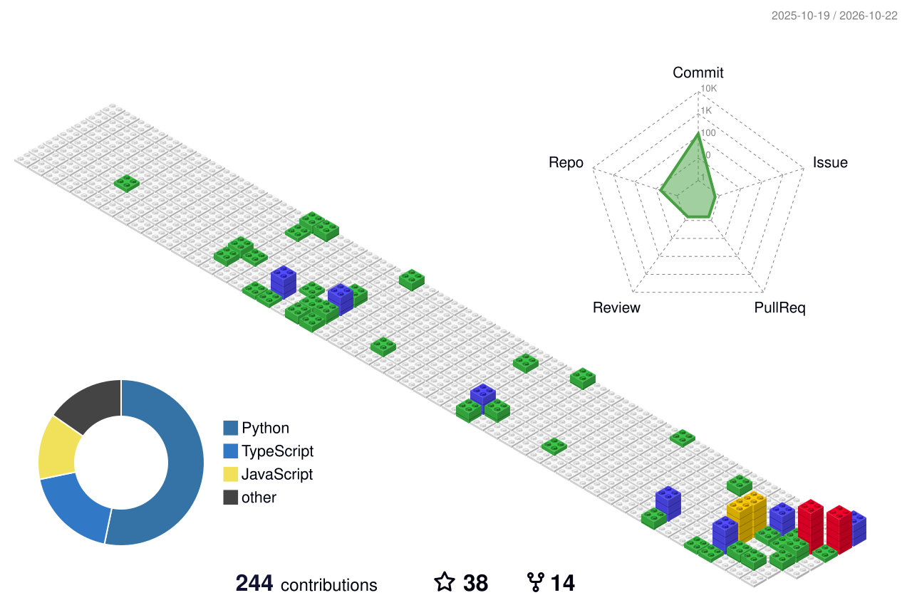

# Mehul Ligade — AI Engineer & Solution Architect

 

&nbsp;
&nbsp;
&nbsp;

 

I build production AI systems where something real is at stake — tight budgets, no internet, live phone calls. Constraints that make the standard solution impossible are where I do my best work.

 

## 📈 What I've Shipped

| &nbsp; | Achievement | Impact |
|:---:|---|---|
| 💰 | **94% AI cost reduction** | 5,00,000+ students served |
| 🤖 | **₹30L+ saved annually** | Multi-agent pipelines replacing manual workflows |
| 📞 | **Voice AI under 500ms** | Live telephony · custom Cerebras CS-2 architecture |
| 📱 | **Full LLM offline in 1 GB** | Quantised on-device model · zero cloud dependency |

 

## 🚀 Open Source Projects

<table>
<tr>
<td width="50%" valign="top">

### 🎬 [vid2anim](https://github.com/mehulcode12/vid2anim)
**Video → 3D Character Animation**

Convert any video into production-ready 3D animation using AI pose estimation and universal skeleton retargeting. Supports Mixamo, VRM, Blender Rigify, Unreal, and more.

`Python` `MediaPipe` `DWPose` `Three.js` `Blender` `MIT`

</td>
<td width="50%" valign="top">

### 🎙️ [Aurora](https://github.com/mehulcode12/aurora)
**Real-Time Voice AI Telephony**

Custom 3-stage inference architecture beating standard LLM APIs by 5–10×. Under 500ms end-to-end on live phone calls. 99.7% production success rate.

`FastAPI` `Docker` `Firebase` `Python`

</td>
</tr>
<tr>
<td width="50%" valign="top">

### 🎨 [agentdraw-canvas](https://www.npmjs.com/package/agentdraw-canvas)
**npm Package · AI Drawing Engine**

Canvas engine giving AI agents a programmatic drawing hand. UUID-keyed shapes, 13 ES modules, 111 weekly downloads at peak.

`JavaScript` `Node.js` `npm`

</td>
<td width="50%" valign="top">

### 📝 [Technical Writing](https://medium.com/@mehulligade12)
**Medium · Production AI Insights**

Writing about productionizing AI, solving edge cases, and moving beyond GenAI wrappers.

</td>
</tr>
</table>

 

## ✍️ Latest from Medium

> Auto-fetches from my [Medium profile](https://medium.com/@mehulligade12) — updates every time I publish.

 

## 🛠️ Tech Stack

 

## 📊 GitHub Stats

  
  

  <picture>
    <source media="(prefers-color-scheme: dark)" srcset="profile-3d-contrib/profile-night-rainbow.svg">
    <source media="(prefers-color-scheme: light)" srcset="profile-3d-contrib/profile-gitblock.svg">
    
  </picture>

 

## ✨ Beyond Code

📖 &nbsp;Authored a chapter in a published book on Artificial Intelligence  
📜 &nbsp;Filed 6 copyrights · 1 patent application in process  
🏆 &nbsp;Won national-level AI project competitions 3×  
👥 &nbsp;Mentored 20+ students on AI implementation

 

## 🤝 Let's Build

> **Open to new opportunities and consulting.** Heavy optimization, architecture bottlenecks, multi-agent systems, AI cost reduction — [let's talk](mailto:mehulligade12@gmail.com).
>
> 🌐 &nbsp;**[mehulcode12.github.io](https://mehulcode12.github.io)** &nbsp;·&nbsp; 💼 &nbsp;**[LinkedIn](https://linkedin.com/in/mehulcode12)** &nbsp;·&nbsp; ✉️ &nbsp;**[mehulligade12@gmail.com](mailto:mehulligade12@gmail.com)**

 

⚡ Recent Engineering Activity

 

<!--START_SECTION:activity-->
1. 🎉 Merged PR [#2](https://github.com/mehulcode12/mehulcode12/pull/2) in [mehulcode12/mehulcode12](https://github.com/mehulcode12/mehulcode12)
<!--END_SECTION:activity-->

 

*The problems I enjoy most are the ones where the standard solution doesn't exist yet.*

